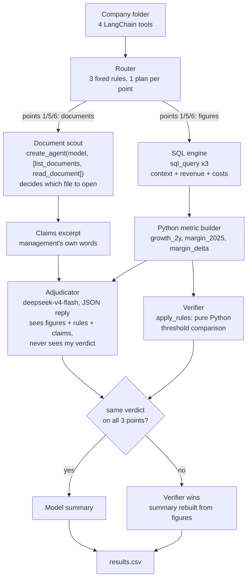

# FTEC5660 Homework 3: Fisher's 15-Point Investment Agent

Build a LangChain agent that researches a company with tools and applies the
framework from Philip Fisher's *Common Stocks and Uncommon Profits* (Part One,
Chapter 3 "What to buy: the fifteen points to look for in a common stock", and
Chapter 4 "What to buy: applying this to your own needs"). You choose 3 of
Fisher's 15 points and decide yourself what PASS means for each. For every
company your agent gives a PASS/FAIL verdict on your 3 points and a short
summary.

The companies are fictional, so the model cannot answer from memory. Unlike a
pile of reports, the evidence is spread over three sources, and your agent has
to go and get it with tools, the way Fisher's "scuttlebutt" method sends an
investor to talk to customers, competitors, suppliers and staff.

## Data and tools

`public_test/` has one folder per company. Your code receives four tools per
company (built by the provided code in `hw3.py`):

| Tool | What it gives you |
| --- | --- |
| `list_documents()` | the company's six documents and their dates |
| `read_document(name)` | one document: the 2025 letter to shareholders, four earnings calls (Q3 2025 to Q2 2026) and a news file (July 2025 to July 2026) |
| `sql_query(query)` | one read-only SQLite query on the company's database; at most 50 rows come back, so use `SUM`, `GROUP BY` and `WHERE` |
| `interview(role, topic)` | what one person says about the company; at most **10 interviews per company** |

The documents are what management says. Management's own claims (such as "we
have never cut research" or "our people are our greatest strength") are not
evidence on their own: check them against the database and the interviews.

**Database tables** (amounts in USD thousands; dates `YYYY-MM-DD`, months
`YYYY-MM`, quarters like `2025Q3`; the fiscal year is the calendar year):

| Table | Columns |
| --- | --- |
| `company` | name, industry |
| `industry_medians` | industry, revenue_growth_2y_pct, new_product_share_pct, new_product_sales_per_rd, operating_margin_pct (one row per industry; use the row for the company's own industry) |
| `orders` | order_id, order_date, product, customer, amount, note (about 3,000 to 4,000 orders from January 2023 to June 2026; revenue is the sum of order amounts) |
| `products` | product, launch_date |
| `monthly_costs` | month, cost_of_sales, selling_admin, research_development |
| `quarterly_cash` | quarter, operating_cash_flow, capex, cash_end |
| `capex_plan` | year, planned_capex (2026 to 2028) |
| `returns` | month, units_shipped, units_returned |
| `insider_trades` | trade_date, person, title, side (`buy` or `sell`), shares, price |

**Terms used in the data.**

| Term | Meaning |
| --- | --- |
| FY2025 | Fiscal year 2025. Here the fiscal year is the calendar year, so FY2025 is January to December 2025. |
| Quarter | Three months of the year: Q1 is January to March, Q2 April to June, Q3 July to September and Q4 October to December. The database writes `2025Q3`; the documents write "third quarter 2025". |
| Amounts | The database is in **USD thousands** (676,100 means US$676.1 million). The documents use USD millions. |
| Revenue | Money from sales: the sum of `amount` in `orders`. |
| Cost of sales | The cost of making the products that were sold. |
| Selling and admin | The cost of selling and of running the company (sales staff, offices, management). |
| R&D | Research and development spending, mainly on new products. |
| Operating margin | Operating profit as a share of revenue: (revenue − cost of sales − selling and admin − R&D) ÷ revenue. |
| Operating cash flow | Cash that the day-to-day business brings in during a quarter. |
| Cash at the end of a quarter | The cash the company holds on the last day of that quarter (`cash_end`). |
| Capex | Capital expenditure: spending on factories, machines and other long-term assets. `capex_plan` holds the planned capex for 2026 to 2028. |
| Return rate | Units returned ÷ units shipped, from the `returns` table. |
| Industry median | The middle value for companies in the same industry, from `industry_medians`. |
| Insider | A director or senior manager of the company. `insider_trades` lists the shares they bought (`buy`) or sold (`sell`). |
| Earnings call | A meeting each quarter where management presents the quarter's results to investors. Each call quotes that quarter's revenue. |

**Interviews.** Roles: `customer`, `current_employee`, `former_employee`,
`competitor`, `supplier`. Topics: `sales_team`, `working_conditions`,
`top_management`, `decision_making`, `competitive_edge`. Only some people know
about each topic; the others say they can't comment, and that answer still
uses up one interview.

| Topic | Who knows about it |
| --- | --- |
| `sales_team` | customer, competitor |
| `working_conditions` | current_employee, former_employee |
| `top_management` | former_employee, supplier |
| `decision_making` | supplier, customer |
| `competitive_edge` | competitor, customer |

People who know about a topic always agree with each other, so one good answer
is enough.

## Choose your 3 points and your rules

Pick any 3 of Fisher's 15 points and write them in `CHOSEN_POINTS` near the
top of `hw3.py`, e.g. `CHOSEN_POINTS = [1, 7, 15]`. The full questions are in
`FISHER_POINTS` in `hw3.py` and in the book.

| # | Fisher's point | Where the evidence is |
| --- | --- | --- |
| 1 | Market potential for sales growth | database |
| 2 | New products as current lines mature | database |
| 3 | Effective research and development | database |
| 4 | Above-average sales organization | interviews (`sales_team`) |
| 5 | Worthwhile profit margin | database |
| 6 | Maintaining or improving margins | database |
| 7 | Labour and personnel relations | interviews (`working_conditions`) |
| 8 | Executive relations | interviews (`top_management`) |
| 9 | Depth of management | interviews (`decision_making`) |
| 10 | Cost analysis and accounting controls | earnings calls, checked against the database |
| 11 | Advantage over competitors | interviews (`competitive_edge`) |
| 12 | Long-range outlook on profits | database |
| 13 | Growth without dilutive equity financing | database |
| 14 | Management talks freely about troubles | earnings calls, checked against the database |
| 15 | Management of unquestionable integrity | news file, checked against the database |

For each of your points, **you design the rule**: which evidence to use, what
to compute or whom to ask, and where the line between PASS and FAIL lies. PASS
means the company looks favourable on that point, as Fisher would see it.

We grade your verdicts against our own answer key. It uses one fixed rule per
point, which we do not publish, and the data never puts a company close to
the line of that rule, so a sensible reading of Fisher usually gives the same
answer. **Test your rules on the public answers**:
`public_test/ground_truth.json` gives the expected verdict on all 15 points
for each of the 20 public companies, and every point fails in 6 of them. If
your rule disagrees with the public answers, rethink it.

**Tip: calculate with tools, not in your head.** Do every sum, ratio and
comparison in SQL or Python, including the number of days between two dates
(SQLite's `julianday()` gives a date as a number of days).

## Student task

Fill in the three places in `hw3.py` marked `### YOUR CODE HERE`. You may add
imports, constants and helper functions above them, but do not change the
provided code below them:

- `CHOSEN_POINTS` lists your 3 points.
- `build_agent()` creates your model and anything else you need once.
- `analyze_companies(agent, companies)` receives
  `{company_folder: [list_documents, read_document, sql_query, interview]}`
  and returns, for every company,
  `{"points": {1: "PASS", 7: "FAIL", 15: "PASS"}, "summary": "..."}` (here with
  `CHOSEN_POINTS = [1, 7, 15]`).

Use the course techniques that fit your points: tool use for the database and
the interviews, planning which interviews to spend, routing each point to the
right source, prompt chaining, parallel calls, reflection to check your
answers, or a combination. Your code must read company data **only through
the four tools**; do not open `company.db` or `interviews.dat` yourself. Do
not hard-code folder names, company names or the public answers.

## Setup and public test

```bash
python3 -m venv .venv
source .venv/bin/activate
pip install -r requirements.txt
echo "DEEPSEEK_API_KEY=your_key_here" > .env
python3 hw3.py --data-folder public_test
```

Use your own DeepSeek API key (from https://platform.deepseek.com). The
required model is `deepseek-v4-flash`. We grade with our own key, so never put
a key in your code; `.env` must stay out of git.

The program creates `results.csv` with the columns `company`, `points`,
`points_correct`, `point_errors`, `interviews_used` and `summary`, and prints
the point score on your 3 points (the percentage after "balanced"). The point
score is the average of two shares: the share of truly passing verdicts that
you marked PASS and the share of truly failing verdicts that you marked FAIL.
For example, 90% and 60% give (90% + 60%) / 2 = 75%, and marking every point
PASS gives (100% + 0%) / 2 = 50%. Once `CHOSEN_POINTS` is set, the starter
runs before you add any API code (it returns no verdicts, so it scores 0%).

`public_test/ground_truth.json` gives the expected verdicts on all 15 points
for each public company. Grading uses a private set of about 20 unseen
companies with the same tools and the same answer key rules, but different
names and wording, and scores your 3 points only.

## Homework 3 solution

### 1. The three points and my rules

| # | Fisher's question | My PASS rule | Evidence | Public score |
| --- | --- | --- | --- | --- |
| 1 | "Does the company have products or services with sufficient market potential to make possible a sizable increase in sales for at least several years?" | Two-year revenue growth FY2023 to FY2025 is **strictly above the industry median** two-year growth. | `orders` (sum of `amount` per year) joined to `industry_medians` | 20/20 |
| 5 | "Does the company have a worthwhile profit margin?" | FY2025 operating margin is **strictly above the industry median** operating margin. | `orders` + `monthly_costs` + `industry_medians` | 20/20 |
| 6 | "What is the company doing to maintain or improve profit margins?" | The FY2025 operating margin is **not lower than** the FY2024 margin (change >= 0.00pp). | `orders` + `monthly_costs`, own history | 20/20 |

Everything is computed in SQL and Python. The model never adds, divides or
compares: it receives the finished figures and applies the rule text.

**Why these three.** Fisher asks three different questions about the same
business, and a company can be good at one and bad at another. Point 1 is
about the size of the opportunity (is there room to grow?), point 5 about the
quality of the economics today (does growth turn into profit?), and point 6
about direction (is the profit pool getting better or worse?). A company that
grows 25% but whose margin erodes is exactly the kind of stock Fisher's
Chapter 3 warns about: growth bought with price cuts. Choosing 1, 5 and 6 lets
the three verdicts contradict each other, which they do: on `public_test`
Ashgrove Labs passes 1 and 5 and fails 6, while Northwind Group fails 5 and 6
despite 24.7% growth.

The second reason is evidence quality. Chapter 3 of the brief routes these
three points to the database, so they can be answered with numbers that are
reproducible. The alternative (points 4, 7, 8, 9, 11) rests on interviews,
where one sentence from a customer decides the verdict and there is nothing to
recompute. Fisher's own method, the "scuttlebutt", is at its strongest where
talk can be cross-checked against figures; where the only evidence is talk, a
PASS is a judgement about a person, not about a business. Since all three of
my points are database points, the agent spends **0 of its 10 interviews** per
company. That is a deliberate budget decision, not an omission: the interview
budget only buys information on points the database cannot answer.

**Point 1 - market potential.** Fisher's question is about a *sizable increase
in sales for several years*, so a single good year is not enough and an
absolute growth rate tells us nothing without the industry context: a 12%
grower in a 20% industry is losing share. I therefore compare the company's
own two-year growth with the median of its own industry, which is what
`industry_medians.revenue_growth_2y_pct` provides. The window is FY2023 to
FY2025 because the database holds orders from January 2023 and FY2026 is only
half complete; a partial year would flatter or punish a company for its
seasonality. PASS is a strict inequality: identical to the median is not
"sufficient market potential".

**Point 5 - worthwhile margin.** "Worthwhile" is a word Fisher deliberately
leaves open, so the rule has to make it concrete. A fixed percentage (say 15%)
would be wrong: a 15% margin is mediocre in medical devices and excellent in
food ingredients. I use the industry median, which asks the question Fisher is
really asking - is this company better than the businesses it competes with -
and the database publishes exactly that benchmark. Operating margin, not gross
margin, because Fisher's subject is the profit the owners keep after the
company has paid for selling and for R&D.

**Point 6 - maintaining or improving margins.** This is a *change* question,
not a *level* question, so the benchmark is the company's own past: the sign of
the FY2024 to FY2025 change in operating margin. Judging a low-margin company
on its level (point 5) and on its direction (point 6) separately is the whole
point of having both. I chose the year-over-year change rather than a
three-year average because Fisher's concern is what management is doing *now*
to protect the margin, and one year is long enough to contain a price war, a
cost programme or a mix shift.

### 2. Design



The agent is a pipeline with three separated roles, because the task has three
different kinds of work in it and one model call should not do all of them. A
**router** holds the rules: each chosen point declares the metric it reads
(`growth_2y_pct`, `margin_2025_pct`, `margin_delta_pp`), the benchmark it is
compared with (industry median, industry median, zero) and the comparison
operator. That mapping is written once, in `RULES`, and is the only place a
point's meaning lives. A **document scout** is the one place where a real
tool-calling agent runs: `create_agent` with only `list_documents` and
`read_document`, bounded to eight steps, so the model decides *which* document
is worth opening and quotes management's claims - work the SQL engine cannot do
and work that cannot corrupt a number, because its output is prose. The
**SQL engine** then runs three fixed queries (context plus medians, revenue per
year, costs per year) through `sql_query` and hands the rows to a Python
metric builder, which computes growth, margins and the margin delta. The
**adjudicator** is the model's judgement step: it gets the finished table, the
rule text verbatim and the scout's claims, and returns JSON verdicts with one
sentence of reasoning each - but it is never shown my own verdict, so its
answer is an independent opinion rather than an echo. The **verifier** closes
the loop: `apply_rules` recomputes every verdict from the same figures in
plain Python. When the two agree, the model's prose goes into the summary
because it reads better; when they disagree, the verifier wins and the summary
is rebuilt from the figures. That asymmetry is deliberate: the model is
allowed to write, not to decide, because a misread digit is silent while an
API failure is loud. Every company runs in its own task with a 300s timeout
and a `try/except`, so one bad company can never cost the other nineteen.

### 3. Results on `public_test`

```
Point accuracy: 60/60 (balanced: 100.0%)
```

All 20 public companies, all 3 points, no disagreements with
`ground_truth.json`; each point fails in exactly 6 companies, which is the
pattern the brief says to expect (every point fails in 6 of the 20). Three
runs of the full 20-company set gave 60/60 each time, in about 30 seconds per
run (28s / 29s / 31s) with six companies in flight.

The closest calls, in percentage points from each rule's line:

| Point | nearest PASS | nearest FAIL | widest gap |
| --- | --- | --- | --- |
| 1 | Hollins Group, +3.09 | Driftwood Systems, -3.39 | -7.28 (Ironbark) to +7.79 (Copperfield) |
| 5 | Kestrel Technologies, +1.71 | Halcyon Works, -1.88 | -4.00 (Everline) to +3.96 (Cobalt) |
| 6 | Halcyon Works, +0.09 | Granite Group, -0.42 | -1.16 (Lindale) to +1.88 (Copperfield) |

Point 6 is the tight one: Halcyon's margin moved +0.09pp and Granite's -0.42pp.
That is still a real sign change, and the answer key agrees with the sign rule
on all 20 - but it is the point I would expect to break first if the private
set contained a company with a margin move of a few hundredths of a point.
Points 1 and 5 have a three-point-wide empty band around their thresholds, so
they are safe.

The model agreed with the verifier on **60/60** verdicts. I report that as a
measurement, not as a result: the adjudicator was given the rule and the
figures but not my answer, so 60/60 says the model reads a table correctly
when the arithmetic has already been done, and says nothing about whether it
would have done the arithmetic. The verifier would have caught the difference:
in an earlier version, structured output was rejected by the endpoint and the
run fell back to the verifier on all 20 companies, and the score was still
60/60 - the model is an improvement to the prose, not to the verdicts.

### 4. What would break, and why I am not worried

- **No API key, bad key, network down, model renamed**: `build_agent` catches
  it and returns an agent with no model; the verifier still produces all three
  verdicts and the template summary. The submission cannot score zero for a
  reason outside its control.
- **A wrong or empty query result**: `build_evidence` returns `None` for a
  missing year instead of raising, `compare()` treats `None` as a fail, and
  the summary prints `n/a` rather than a fake number.
- **A model that ignores the JSON instruction**: `extract_json` balances braces
  and `read_verdicts` accepts both `{"points": {"1": ...}}` and
  `{"points": {"p1": ...}}`, the two shapes the model actually produced. A
  reply that yields no verdict at all is ignored, not trusted.
- **No hard-coding**: no company name, folder name or expected verdict appears
  anywhere in `hw3.py`; the only constants are years, thresholds and the rules
  themselves. The 20 public companies are never read from disk except through
  the tools.
